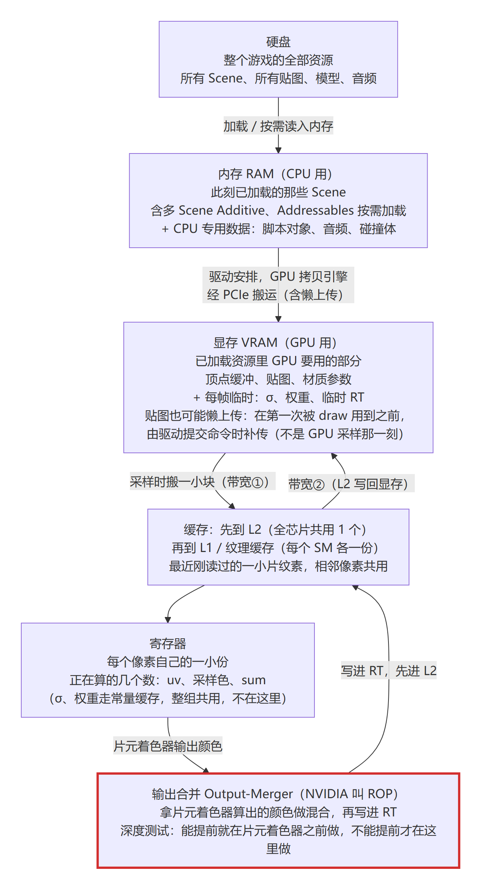
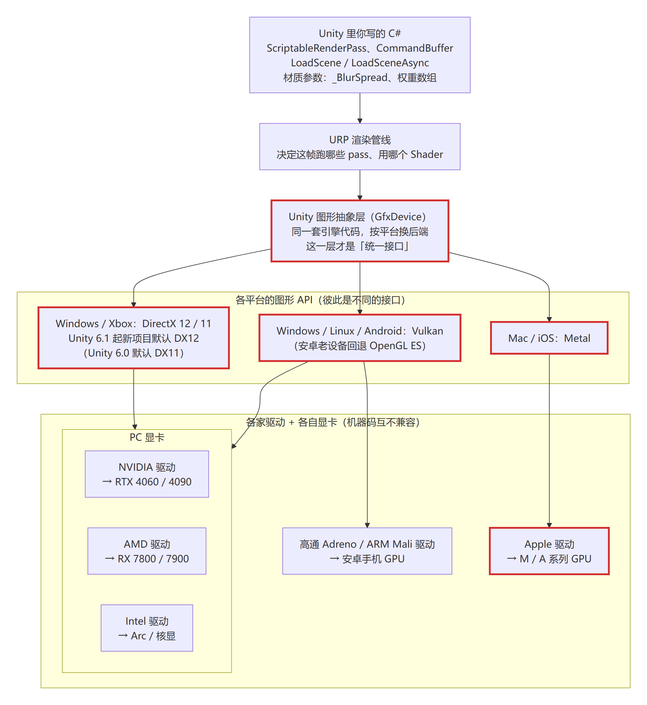
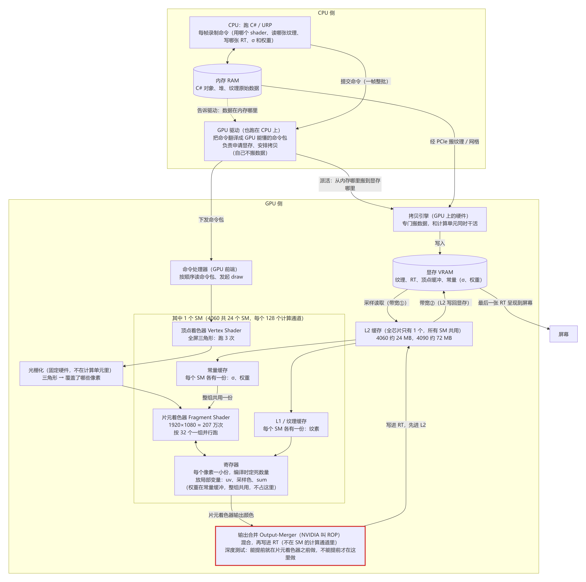
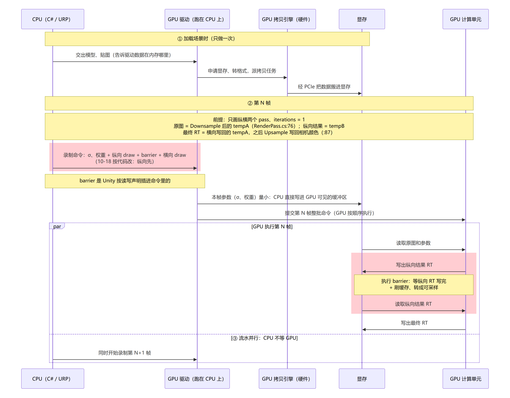
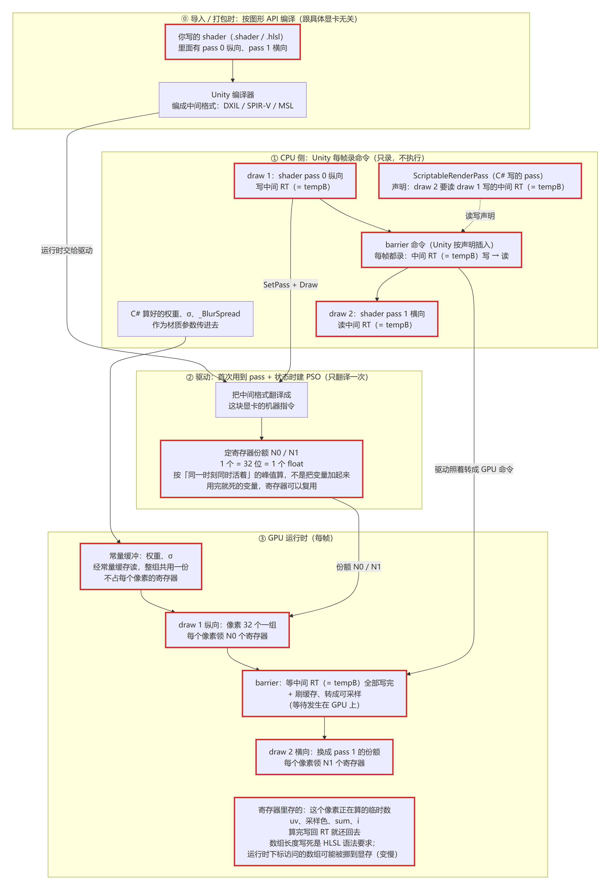
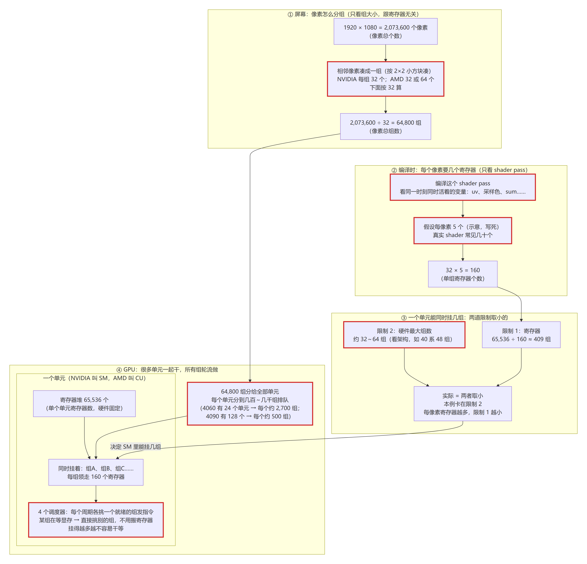
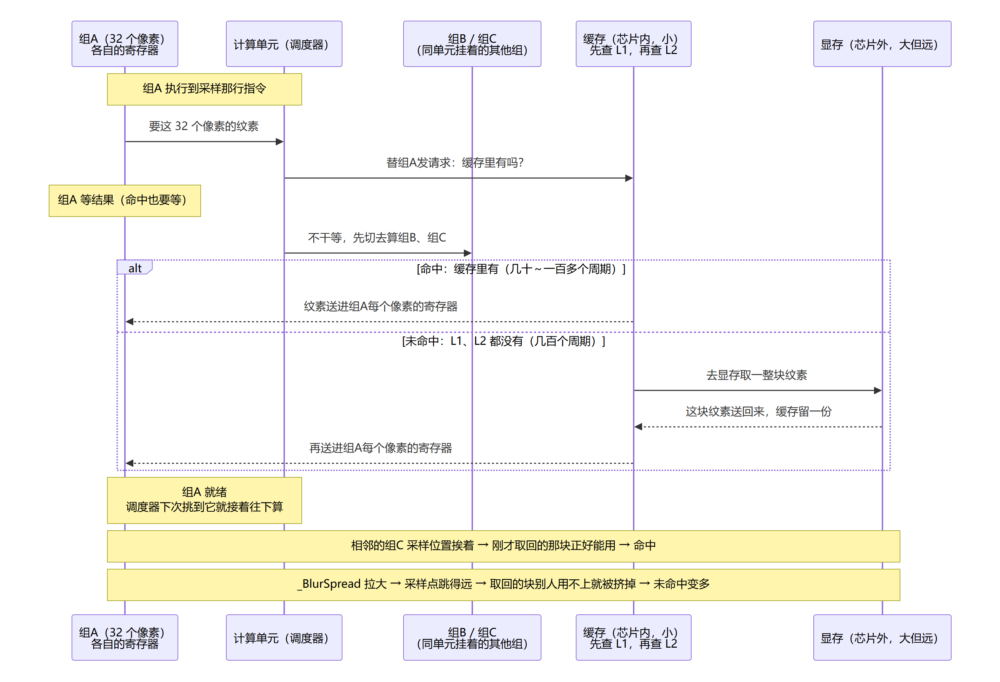
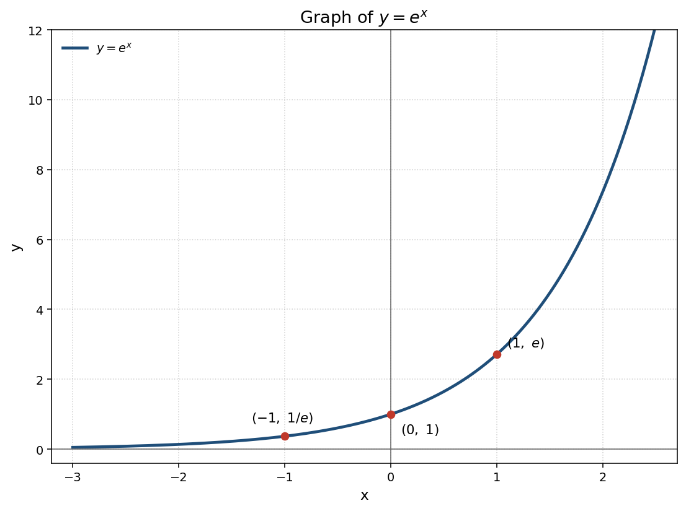
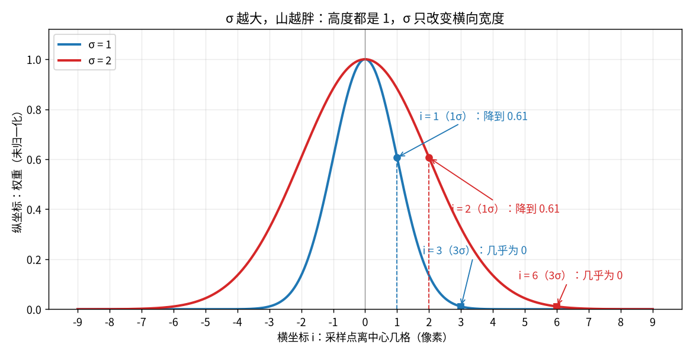

# Week 3 · Day 2 笔记（2026-10-08 · 数据怎么流到 GPU：存储层级、寄存器、缓存）

**本周验收**：解释全屏后处理在移动端为何贵、降分辨率为何有效。
**来源**：10-07 – 10-08 回答 W3-D1 第 0 节时，自己追问到底层画的 7 张流程图（`图片/W3/D2/`）+ 2 张高斯曲线图（`图片/W3/D1/`）。本笔记把图里的结论整理成文字 + 自测题。
**和计划的关系**：原定 D2 主题是「带宽」，这两天的内容正好覆盖了带宽的前半段（数据从哪搬到哪、缓存为什么重要），还多学了寄存器与占用率。**寄存器／占用率到此为止，不再往下挖**——W3 验收用不到更深的内容。
**D2 验收（2026-10-19，Navigator）**：✅ 通过。第1–5节自测、第9节第1、3题和第4题（F23补算区）都经 Atlas 检查通过（2026-10-18/19）。第4节寄存器自测不计入（F20），第9节第2题已退出验收。这只是 D2 当天通过，W3 阶段验收另判。W3-D1 已于 10-14 完成。

---

## 1. 存储层级：数据从硬盘到寄存器



**要点**
1. 硬盘 → 内存（CPU 用）→ 显存（GPU 用）→ 缓存 → 寄存器，越往下越小、越快、离计算越近。
2. 每帧都会发生的搬运只有两次：**采样时从显存读（带宽①）**、**写回结果 RT（带宽②）**。上传模型、贴图主要发生在加载时。
3. 缓存里放的是「最近刚读过的一小片纹素」，相邻像素可以共用。

**自测**：一个全屏 pass 每帧至少产生哪两次显存访问？ __采样读取的时候L2缓存读取显存带宽1 ，<span style="color:red">结果RT写回显存带宽2（曾错写成「寄存器写回显存」：寄存器不直接写显存，写回的是结果 RT，经输出合并 → L2 → 显存）</span>__

---

## 2. 从 C# 到显卡：中间隔了哪几层




**要点**
1. C# / URP 决定「这帧跑哪些 pass、用哪个 shader」→ Unity 的图形抽象层把同一套渲染调用转给当前平台用的图形 API（DX12、Vulkan、Metal 彼此是不同的接口；每一个对支持它的各家显卡是同一套接口，由各家驱动实现）→ 各家驱动翻译成自家显卡的指令。【原文】[Unity 6.3 · SRP introduction](https://docs.unity3d.com/6000.3/Documentation/Manual/scriptable-render-pipeline-introduction.html)：Unity 把命令交给底层图形架构，再由它向图形 API 发指令。（2026-10-18 按 V37 改）
2. **驱动运行在 CPU 上**（图 03 里它在 CPU 侧），负责申请显存、上传数据、下发 draw。
3. 最后一张 RT 呈现到屏幕。

**自测**：为什么同一个 shader 能在 NVIDIA 和手机 GPU 上都跑？是谁做了翻译？ __各个平台的显卡驱动__

---

## 3. 一帧里的时间顺序



**要点**
1. 加载场景时上传一次模型和贴图；每帧只写本帧参数（σ、权重）并下发 draw。
2. 前一个 draw 写完 RT，后一个 draw 才能读它，中间是 **barrier**。本工程是纵向先、横向后：纵向 tempA→tempB，横向 tempB→tempA（`GaussianBlur_RenderPass.cs:80-84`，2026-10-18 按 V37 改）。
3. CPU 录制第 N+1 帧时，GPU 可能还在算第 N 帧，这是 CPU 和 GPU 之间的流水并行。

**自测**：模糊的横向 pass 为什么不能和纵向 pass 同时开始？（2026-10-18 按 F34 改：原题先后写反；下面答案按原题作答，按原理判通过，不标红。） __因为他们有依赖关系纵向pass必须等横向pass全部计算完拿它的结果作为输入__

---

## 4. 寄存器与占用率（到此为止）

> **学习状态/范围（2026-10-16，F20）**：寄存器计算为补充材料，用户尚未掌握，暂不计入本次D2掌握或验收范围。不在D2继续展开；将来实际涉及后再确定迁移位置，并由Atlas配合图文编号与引用调整。




**要点**
1. shader 先被 Unity 编成中间格式（DirectX 平台在 6000.3 默认用 FXC 编成 DXBC，改用 DXC 编译器才是 DXIL；另有 SPIR-V / metallib），驱动第一次用到时再翻译成机器指令。（2026-10-18 按 V18 已查结论改，原写 DXIL，与第2点 DXBC 不一致）
2. **编译时声明寄存器**：编译出的中间代码（DXBC）里，用到几个临时寄存器（register）是声明好的。【原文】[dcl_temps](https://learn.microsoft.com/en-us/windows/win32/direct3dhlsl/dcl-temps)：“Declares temporary registers.”，每个寄存器放一个 32 位四分量值。显卡驱动还会把中间代码再编译一次，最终用多少个硬件寄存器由驱动决定【推断】。（10-13 按 Verifier 查证 V1 补）
   - **数组长度必须写死**：【原文】HLSL 规定数组维度必须是字面量（literal）标量表达式（错误 3058 `ERR_ARRAY_LITERAL`，[HLSL errors and warnings](https://learn.microsoft.com/en-us/windows/win32/direct3dhlsl/hlsl-errors-and-warnings)）。运行时才知道的值不是字面量，所以数组长度不能运行时决定。
   - **分清两种数组**：
     - shader 函数里的**局部数组**：编译后变成固定大小的临时寄存器数组。【原文】[dcl_indexableTemp](https://learn.microsoft.com/en-us/windows/win32/direct3dhlsl/dcl-indexabletemp)：“Declares an indexable, temporary register.”，`[size]` 是 “The number of elements in the register array”。
     - C# 用 `SetFloatArray` 传进来的数组（如 W3-D1 0b 做法 A 的 `weights[19]`）：放在**常量缓冲区（constant buffer）**里，不占临时寄存器；每个元素占一个 16 字节的位置。【原文】[Packing rules for constant variables](https://learn.microsoft.com/en-us/windows/win32/direct3dhlsl/dx-graphics-hlsl-packing-rules)：“every element in an array is stored in a four-component vector”。
   - 「因为寄存器，所以长度要写死」这个因果：**没找到原文，维持【推断】**。
3. 1920×1080 ÷ 32 ≈ 64,800 组。一个计算单元（NVIDIA 叫 SM）能同时挂几组，取「寄存器够分几组」和「硬件最大组数」两者中的小值。
4. 挂的组越多，越容易在某组等显存时切去算别的组。

**自测**：每像素用的寄存器变多，为什么可能变慢？ ____

---

## 5. 采样时怎么取数据：缓存命中与未命中



**要点**
1. 命中缓存：几十个周期；未命中：要去显存取一整块，几百个周期。
2. 等待期间计算单元不闲着，切去算同单元挂着的其他组。
3. 相邻组采样位置挨着，刚取回的那块正好能用，命中率高。
4. **`_BlurSpread` 拉大 → 采样点跳得远 → 取回的块别人用不上就被挤掉 → 未命中变多**。所以 spread 不只是画质问题（重影），也是性能问题。

**自测**：Sobel 的 9 个采样点和 spread = 3 的模糊，哪个缓存更友好？为什么？ __Sobel 的 9 个采样点对缓存更友好因为没有跳过像素就是相邻像素相比于跳过像素更少的返回显存拿数据__

---

## 6. 高斯公式的图像理解




**要点**
1. `e^x` 在 x = 0 时等于 1，x 越负越接近 0。高斯公式的指数 `-i²/(2σ²)` 永远 ≤ 0，所以权重在中心最高（= 1），向两边衰减。
2. σ 只改变曲线的**宽度**，不改变高度（未归一化时中心都是 1）。
3. 图里标得很清楚：**1σ 处降到 0.61，3σ 处几乎为 0**。这就是 W3-D1 0a 第 1 题的答案（61%，不是 95% 或 68%）。

---

## 7. 两处需要修正或补充

> **学习状态/范围（2026-10-16，F20）**：寄存器计算为补充材料，用户尚未掌握，暂不计入本次D2掌握或验收范围。不在D2继续展开；将来实际涉及后再确定迁移位置，并由Atlas配合图文编号与引用调整。

1. **barrier 是谁插的**（图 05）：图里写的是驱动根据读写声明插入。在 DX12 / Vulkan 这类新 API 下，驱动不再替你追踪依赖，是 **Unity 的 Render Graph 根据 pass 的读写声明自己算出依赖并下发 barrier**；只有 DX11 / OpenGL 这类旧 API 才由驱动自动处理。
2. **寄存器的数字只是示意**（图 06）：真实 shader 每像素通常要 20–64 个寄存器。按 64 个算，一组要 32 × 64 = 2048 个，65,536 ÷ 2048 = 32 组，这时卡住的就是寄存器，不是硬件最大组数了。
3. **DX12 是不是你工程的默认 API**（图 02）：工程设置里 Windows 是自动选择。看 Unity 编辑器标题栏末尾的 `<DX12>` 或 `<DX11>` 就能确认，填在这里：__对是<DX12>确认__

---

## 8. 这些和 W3 验收的关系

- 每个全屏 pass 都要「从显存读一整屏 + 写回一整屏」，这就是**带宽成本**。
- 采样点越多、越分散，读得越多、缓存越不友好。
- 【原文】减少外部内存访问能明显省电：[Arm · Tile-Based Rendering §3，p.10](https://documentation-service.arm.com/static/636dfb934e6cf12278ad8c27)「Fragment-heavy content can be made significantly more energy efficient by reducing the number of external memory accesses the GPU needs for common framebuffer operations.」分块渲染（TBR）就是为少访问外部内存设计的：【原文】[Arm 博客 · The Mali GPU: An Abstract Machine, Part 2](https://developer.arm.com/community/arm-community-blogs/b/mobile-graphics-and-gaming-blog/posts/the-mali-gpu-an-abstract-machine-part-2---tile-based-rendering)「designed to minimize the amount of power hungry external memory accesses」。【原文】移动设备的内存带宽比桌面受限：[Arm · GPU Best Practices Developer Guide（101897_0304_10_en，Rev 3.4）§2.3 Memory bandwidth，p.15](https://documentation-service.arm.com/static/67a62b17091bfc3e0a947695)「Memory bandwidth requires a lot of power. Therefore, memory bandwidth is more restricted in mobile devices compared to desktop systems.」【推断】所以在移动 GPU 上，要特别留意每个全屏 pass 带来的外部内存流量。上面原文比的是带宽受限程度，不是「同一个 pass 在手机和 PC 上耗时谁更长」；本项目也没有在手机上实测。这是 W3-D3 TBR 要接着讲的。（2026-10-21 按 F48 / V47 改）
- 降分辨率同时减少了片元次数和读写的字节数。这是 W3-D4 的内容。

---

## 9. 带宽算账：一帧搬多少字节（约 90 分钟）

**当前有效范围（V27，2026-10-16）**：本次以本段、9c当前范围及每道题前的“当前题面”为准。下面保留的理想复用解释、两列差额要求、旧题及用户原答案均为历史记录；与新范围冲突时不继续执行旧要求。整图一次基准只作源图尺寸参考，退出本轮D2验收，不要求重答缓存知识。

【推断·当前模型】沿用D1的固定采样教学模型：目标覆盖像素数 × 模型中每目标像素的采样调用数，再乘统一的过滤足迹上界和每纹素字节，得到无复用读取估算。它只用于固定假设下的算术比较，不是当前运行真实采样次数或显存流量。

【原文·代码边界】本机SRP Core的非材质 `AddBlitPass` 完整重载（`RenderGraphUtilsBlit.cs:370-469`）在 `canUseCopyPass` 条件成立时提前调用 `AddCopyPass`。默认双线性参数不能证明实际走采样路径；[SRP Core 17.3 RenderGraphUtils · AddCopyPass说明](https://docs.unity3d.com/Packages/com.unity.render-pipelines.core@17.3/api/UnityEngine.Rendering.RenderGraphModule.Util.RenderGraphUtils.html)也说明自动择路。当前练习不判定运行时路径，不要求重做D1。下方历史“源码总采样调用数”在本次只能按上述教学模型使用。

**前提**：接 W3-D1 第 2、3 节的采样次数表。分辨率 1920×1080；高斯模糊 `iterations = 1`、`downSample = 2`，「高斯模糊」「边缘检测」两个 feature 都打开。读的代码是 `EdgeDetection_RenderPass.cs`、`GaussianBlur_RenderPass.cs`（工程 `F:\unity\UnityShaderBook`）。

**简化模型（教学算账，不是硬件流量保证）**：只比较同一个 pass 的源纹理有效载荷读取估算，不是实际显存总线流量；写入目标 RT 的量另算。这里的“整屏”是本次处理覆盖的范围，不表示整张 RT 同时驻留二级缓存（L2 cache）。

【推断·模型定义】总采样次数 = 目标覆盖像素数 × 每目标像素的源码采样调用数；源 RT 像素数统计被读取纹理的尺寸，两者不是两张待比较的纹理。

```
逻辑写入字节 = 目标 RT 像素数 × 每像素字节
无缓存复用的读取估算 = 总采样次数 × 每次采样最多涉及的纹素数 × 每纹素字节
整图一次基准 = 源 RT 像素数 × 每纹素字节
```

【推断·理想估算前提】最后一式先定义为整张源图每个纹素各计一次的尺寸基准。只有额外假设完整源图访问、初始冷缓存、每个源纹素累计只从显存取回一次时，才把它解释成理想有效载荷读取量。可按局部区域陆续取回新数据，相邻采样复用缓存；一个区域最后一次使用前，其仍需复用的数据未被淘汰，此后即使被替换，也不再增加本 pass 的重复读取。不要求整张 RT 同时放进 L2，也不假设所有复用一定发生在 L2。缓存内部读取仍有传输与处理成本，本节只不把它重复计作外部显存读取。

【推断·使用边界】下采样不一定访问源图所有纹素；若未访问完整源图，上式只能保留为“整张源图各取一次”的统一教学基准，不能称该 pass 的严格下限。实际缓存按块取数，过滤位置、缓存淘汰、压缩、跨 pass 已缓存数据等也影响硬件流量，因此这里两式不是实际显存流量的保证区间。两列分别命名为“无复用读取估算”和“整图一次基准”，不将其解释为实测上下界。下采样是否完整访问取决于比例、采样坐标和过滤足迹，不能由 Downsample 名称断定；本题等比例全屏映射、downSample=2、理想像素中心对齐的双线性足迹可以覆盖源图。单层 mip、无各向异性过滤和双线性最多涉及四个纹素的原有条件继续适用；源码及官方链接沿用原段，不以 CUDA 的缓存描述证明本工程一定使用相同硬件路径。

- **每次采样最多读几个纹素**：这几个 pass 都用双线性过滤（bilinear）。shader 里写的是 `sampler_LinearClamp`（`EdgeDetection.shader:63`、`:82`，`GaussianBlur.shader:36`、`:43`）；Downsample / Upsample 用的 `AddBlitPass(src, dst, scale, offset, …)` 默认 `filterMode = BlitFilterMode.ClampBilinear`（工程 URP 包 `com.unity.render-pipelines.core/Runtime/RenderGraph/RenderGraphUtilsBlit.cs:381`）。【原文】[Bilinear Texture Filtering](https://learn.microsoft.com/en-us/windows/win32/direct3d9/bilinear-texture-filtering)：双线性过滤是 “calculate the weighted average of the 4 texels closest to the sampling point”。
  - **前提**：RT 只有一层 mip、没开各向异性过滤。三线性过滤要读两层 mip，会超过 4 个。这几张 RT 都按单层创建，Blit 读的是 `_BlitMipLevel` 指定的那一层，所以这里「最多 4 个」成立【推断】（10-14 按 Verifier 查证 V12 补）。

**模型参数**：1920×1080，`downSample = 2`、`iterations = 1`，两个 feature 开启；全屏覆盖，单采样、无动态分辨率或额外视口缩放，单层 mip、无各向异性过滤，格式以9a观察为准。双线性最多四个纹素是过滤足迹上界，不代表四笔外部显存事务。各 pass 独立估算后相加，不代表实际同帧总线流量。缓存局部复用是理想假设，不是硬件调度保证。

### 9节补充：流量、速率与模型差额

**比较对象和单位**：本段只讨论外部显存读取，不把缓存内部读取重复计入；写回结果另算。【推断·单位定义】流量（data volume）是在指定统计范围或时间段内累计的数据量，用MB等单位。按帧归一后可写MB/帧，表示平均每帧读取量；给定帧率后才能换算时间速率。传输速率（transfer rate）是数据量除以时间，例如GB/s；谈“带宽消耗”时要写明采用的速率口径。硬件带宽能力（memory bandwidth capacity）是理论峰值或给定条件下可持续的传输能力，与本次工作负载测得的速率要分开。

**单位分层（2026-10-18 按 F28 补，V35 查证）**：位（bit）是一个二进制位，这里用来说格式精度，例如 R8G8B8A8 每个通道 8 bit。字节（byte，B）是数据量的基本单位，1 B = 8 bit，例如每纹素 4 B。兆字节（MB）用来写大量数据，本笔记取十进制 1 MB = 1,000,000 B（9d 参数行）；有的工具用二进制 1 MiB = 1,048,576 B，本题不用。【原文】[NIST · Prefixes for binary multiples](https://physics.nist.gov/cuu/Units/binary.html)：1 MB = 10^6 B，1 MiB = 2^20 B = 1 048 576 B，1 B = 8 bit。

速率 = 数据量 ÷ 时间。常见写法里大写 B 是字节、小写 b 是位（IEC 80000-13 里位的符号写作 bit），所以 Gb/s 和 GB/s 数值相同时差 8 倍。【原文】[Micron · GDDR7 送样新闻稿，2024-06-04](https://investors.micron.com/news-releases/news-release-details/micron-samples-next-gen-graphics-memory-gaming-and-ai)：显存每个引脚的速率写作「32 Gb/s」，系统带宽写作「1.5 TB/s」。本笔记「MB/帧 × 帧率」得到的 GB/s 是模型估算的传输速率，不是硬件带宽能力（见上段三层口径）。

注意两处变量名：下面 F23 补算表里的小写 b 是变量「每纹素字节数」（本题 b = 4 B），不是 bit；两张表表头的大写 B 是变量「无复用估算」，单位写在括号里（字节）。

【推断·模型与测量】9c两列差额只是两种假设下的有效载荷估算之差，不能直接称为实际节省。缓存复用可以减少重复外存读取，CUDA纹理缓存示例说明这一机制；应用到本工程仅作一般机制解释，不代表已测收益；要判断实际省了多少，应明确基线及改动，固定比较边界、指标、输入、输出质量及设备/运行配置，采用同口径测量值比较；区分每帧读取量与平均读取速率，不能因GB/s下降就断言每帧字节减少，运行时间也可能变化。这不要求新增实验。若没有测量，只报告模型差额，不推断实际收益大小。

【推断·数据量与事务】“整图一次基准”累计的是每个源纹素各计一次的数据量；不是整个pass只发起一次硬件事务（memory transaction），也不是先把整张RT预加载到L2。实际取数可能按缓存行或块发生，相邻访问复用其中数据；双线性过滤本身不保证每块只取一次。仍需的数据从某一级缓存淘汰后，再访问可能由更下一级缓存满足；只有相关缓存层级无法满足时，才需要再次从外部显存取回。块中也可能含本次未用到的数据。分块取数本身不能证明必然更费流量，须结合访问与复用情况判断。

**学习状态**：用户已经能说明“缓存命中不重复读显存，未命中需取数据”。本补充用于澄清统计口径，不要求重答该核心，也不要求计算硬件事务数。已有答案保持原样。

【推断·来源与范围】以上按[NVIDIA指南 §9.2.1–3 带宽计算与计量层次](https://docs.nvidia.com/cuda/cuda-c-best-practices-guide/index.html#effective-bandwidth-calculation)、[§10.2.1 合并访问与事务](https://docs.nvidia.com/cuda/cuda-c-best-practices-guide/index.html#coalesced-access-to-global-memory)、[§10.2.5 纹理缓存](https://docs.nvidia.com/cuda/cuda-c-best-practices-guide/index.html#texture-memory)限定模型含义；CUDA具体事务尺寸和缓存路径不能直接套到本Unity工程。新增层级条件不代表用户缓存核心答错。

### 小例子：4×4源图中重复使用同一片数据

**前提**：这是独立教学例子，不是Unity工程的采样坐标设置。整张源渲染纹理（render texture，RT）为4×4，共16个像素；连续两次采样都需要左上同一2×2的四个像素，每像素数据为b字节。这里4×4是整张源图，2×2是本例所需区域，都不是指定的硬件缓存块大小。首次所需数据不在相关缓存层级；不指定过滤权重、缓存块字节数或硬件事务数。

【推断·有效载荷模型】两次采样共使用8份像素数据：理想复用假设第二次仍能从缓存取得这四个像素，累计外部读取有效载荷计4b字节；无复用模型每次都重新计入这四份，累计计8b字节。这是同一源图、同样采样需求下，仅复用假设不同的比较，不是按块搬运与逐像素搬运的比较。

【推断·统计边界】两次只涉及4个不同像素，未访问全部16个。整图一次基准是16b字节的尺寸基准，不能当成本例实际读取量。4b、8b都不是DRAM实测搬运量，也不是4次、8次硬件事务。实际块粒度及未用数据可能影响搬运量，某级缓存未命中也不等于必然读DRAM，沿用前文层级边界。

【推断·结论】9c算读取字节，不数硬件事务；这不表示与访问次数毫无关系，无复用估算仍包含总采样调用次数。分批取回可发生多次访问而不重复取同一份数据；“各取一次”指累计每份数据只计一遍，不是整图一笔传输或预装整图。缓存内部读取仍有成本。本例不新增题目，不要求重答缓存核心，也不替填9d。

参考来源及适用范围：[NVIDIA §9.2.3 请求与DRAM吞吐口径](https://docs.nvidia.com/cuda/cuda-c-best-practices-guide/index.html#throughput-reported-by-visual-profiler)、[§10.2.1 访问合并与事务粒度](https://docs.nvidia.com/cuda/cuda-c-best-practices-guide/index.html#coalesced-access-to-global-memory)、[§10.2.5 纹理缓存](https://docs.nvidia.com/cuda/cuda-c-best-practices-guide/index.html#texture-memory)。上述是CUDA文档的一般机制参考；4b/8b/16b来自本例假设的模型算术，不是文档实测或Unity硬件保证。

### 9a. 查格式：每像素几个字节（20 分钟）

1. 「高斯模糊」「边缘检测」两个 feature **都打开**（本节前提），打开 Frame Debugger，记下下面四张 RT 的格式：
   - 相机颜色和模糊中间 RT：在 W3-D1 第 3a 节列的高斯模糊 pass 里找。
   - 边缘检测中间 RT（`dst`）：在 W3-D1 第 2 节的 `EdgeDetectionPass` 里找（它写的目标就是 `dst`，资源名 `_BlurTexture`，见 `EdgeDetection_RenderPass.cs:67`、`:74-75`）。
   - （10-15 补：原来只写了「找 3a 的 pass」，那里只有高斯模糊，找不到 `dst`。）

   > **参数**：1920×1080，`downSample = 2`、`iterations = 1`，两个 feature 开启；单采样，全屏覆盖，无动态分辨率或额外视口缩放。四行分别是相机颜色、tempA、tempB、边缘检测 dst；格式取当前 Frame Debugger 捕获，每像素字节由该格式换算。

   | RT | Frame Debugger 里的格式 | 每像素字节 |
   |---|---|---:|
   | 相机颜色 `_CameraTargetAttachment` | R8G8B8A8_UNorm <span style="color:red">（10-22 W4-D2 实测为 B10G11R11_UFloatPack32，也是每像素 4 B，字节数不受影响；见 F54 / V57）</span> | 4B |
   | 模糊中间 RT（tempA） | R8G8B8A8_UNorm | 4B |
   | 模糊中间 RT（tempB） | R8G8B8A8_UNorm | 4B |
   | 边缘检测中间 RT（`dst`） | R8G8B8A8_UNorm | 4B |

   - 两张中间 RT 在代码里是 `RenderTextureFormat.Default`（`GaussianBlur_RenderPass.cs:26-27`、`EdgeDetection_RenderPass.cs:26`）。【原文】[RenderTextureFormat.Default](https://docs.unity3d.com/ScriptReference/RenderTextureFormat.Default.html)：“will be chosen accordingly to Frame Buffer format and Platform. Typically this is ARGB32 format.” 所以**以 Frame Debugger 里实际看到的为准**。
   - 查字节数：格式名里通道字母后面的数字是该通道的位数，加起来除以 8。【原文】例如 [GraphicsFormat.B10G11R11_UFloatPack32](https://docs.unity3d.com/ScriptReference/Experimental.Rendering.GraphicsFormat.B10G11R11_UFloatPack32.html)：“A three-component, 32-bit packed unsigned floating-point format”。
   - ⚠️ 别把末尾的 `Pack32` 也加进去：它是整个像素的**总位数**，不是一个通道。压缩格式（BC、ASTC 等）也不能这样算，但这节的四张 RT 都不是压缩格式。
   - ⚠️ `RenderTextureFormat` 的旧名字也不适用这个规则：`ARGB32` 里的 32 是**总位数**。【原文】[RenderTextureFormat.ARGB32](https://docs.unity3d.com/ScriptReference/RenderTextureFormat.ARGB32.html)：“Color render texture format, 8 bits per channel.” 以 Frame Debugger 里显示的 `R8G8B8A8_…` 这类名字为准（10-14 按 V12 补）。

### 9b. 逻辑写入字节（20 分钟）

按 W3-D1 第 2、3a 节的 pass 顺序填。MB 按 1 MB = 1,000,000 字节算。

> **参数（同本节开头的前提）**：分辨率 1920×1080，`downSample = 2`，`iterations = 1`，两个 feature 都打开。表里 6 行 = 高斯模糊 4 个 pass（W3-D1 第 3a 节）+ 边缘检测 2 个 pass（W3-D1 第 2 节：`EdgeDetectionPass`、`ED_CopyPass`）。目标 RT 的尺寸可以抄 W3-D1 第 3b 节 `downSample = 2` 那一行。（10-15 补）格式和每像素字节取9a；单采样、全屏覆盖，无动态分辨率或额外视口缩放；本表为逻辑写入有效载荷，不是实际总线流量。

| pass | 目标 RT 像素数 | 每像素字节 | 写入 MB |
|---|---:|---:|---:|
| Gaussian Blur Downsample Pass | 960x540 | 4B | 2.0736MB |
| Vertical GAussian Blur RenderPass | 960x540 | 4B | 2.0736MB |
| Horizantal GAussian Blur RenderPass | 960x540 | 4B | 2.0736MB |
| Gaussian Blur Upsample Pass | 1920x1080 | 4B | 8.2944MB |
| **合计** | 1920x1080+3x960x540 | 4B | 14.5152MB |
| EdgeDetectionPass | 1920x1080 | 4B | 8.2944MB |
| ED_CopyPass | 1920x1080 | 4B | 8.2944MB |
| **合计** | 2x1920x1080 | 4B | 16.5888MB |

### 9c. 读取估算：无复用与整图一次基准（30 分钟）

**9c当前范围**：只使用“无复用读取估算”列；调用数按D1固定采样教学模型。最后一列仅保留源图尺寸参考，不解释为本工程理想读取量，不要求求两列差额。下方旧参数中的理想复用解释不再作为当前练习要求。

> **参数**：1920×1080，`downSample = 2`、`iterations = 1`，两个 feature 开启；单采样、全屏覆盖，无动态分辨率或额外视口缩放；格式/每纹素字节取9a，1 MB = 1,000,000字节。六行源RT依次为相机颜色、tempA、tempB、tempA、相机颜色、dst。总采样次数抄W3-D1第2节及第3b节，须包含每目标像素的调用次数。无复用读取估算=总采样次数×最多涉及纹素数×每纹素字节；整图一次基准=源RT像素数×每纹素字节，只有第9节理想条件成立时才解释为理想读取量，不要求整图驻留L2。两组合计按各pass独立口径相加，不是实际流量界限。

| pass | 采样次数（抄 W3-D1） | 每次采样最多读几个纹素 | 源 RT 像素数 | 每纹素字节 | 无复用读取估算 MB | 整图一次基准 MB |
|---|---:|---:|---:|---:|---:|---:|
| Gaussian Blur Downsample Pass  | 960x540 | 4 | 1920x1080 | 4B | 8.2944MB | 8.2944MB |
| Vertical GAussian Blur RenderPass | 5x960x540 | 4 | 960x540 | 4B | 41.472MB | 2.0736MB |
| Horizantal GAussian Blur RenderPass | 5x960x540 | 4 | 960x540 | 4B | 41.472MB | 2.0736MB |
| Gaussian Blur Upsample Pass | 1920x1080 | 4 | 960x540 | 4B | 33.1776MB | 2.0736MB |
| **合计** | 1920*1080+11*960*540 | 4 | 1920*1080+3*960*540 | 4B | 124.416MB | 14.5152MB |
| EdgeDetectionPass | 10x1920x1080 | 4 | 1920x1080 | 4B | 331.776MB | 8.2944MB |
| ED_CopyPass | 1920x1080 | 4 | 1920x1080 | 4B | 33.1776MB | 8.2944MB |
| **合计** | 11*1920*1080 | 4 | 2*1920*1080 | 4B | 364.9536MB | 16.5888MB |

> **结论**：两种教学模型的对比，最大最小不能直接直接当作实际真实流量的上下界

### 9d. 检查点（20 分钟）

**参数**：1920×1080，`iterations = 1`，两个feature开启；单采样、全屏覆盖，无动态分辨率/额外视口缩放，格式与每像素字节取9a；1 MB = 10^6字节，1 GB = 10^9字节。`downSample = 2`；分别将9c无复用读取估算、整图一次基准与9b逻辑写入相加，各pass按独立模型累计。

**当前第1题参数**：相机1920×1080、iterations=1，两个feature开启；单采样、全屏覆盖，无动态分辨率或额外视口缩放，单层mip、无各向异性过滤。格式及每纹素字节取9a且比较间固定，过滤方式保持不变，每调用固定采用4纹素的过滤足迹上界。调用量沿用D1固定采样教学模型，不判定默认blit的实际运行路径。downSample=2；1 MB=1,000,000字节，1 GB=1,000,000,000字节，60帧/秒。

**当前第1题题面**：高斯模糊四个pass、边缘检测两个pass分别累计。只将9c无复用读取估算与9b逻辑写入相加，计算MB/帧，再换算60帧/秒的GB/秒模型值。整图一次基准的合计退出验收，不是设备实测。

1. 两种教学合计各多少MB/帧？按60帧/秒分别换算为多少GB/秒的估算流率？不是设备带宽实测。 __高斯读取：无复用 124.416 MB/帧，整图一次基准 14.5152 MB/帧；边缘检测读取：无复用 364.9536 MB/帧，整图一次基准 16.5888 MB/帧。高斯写入：14.5152 MB/帧；边缘检测写入：16.5888 MB/帧。读写合计估算流率：高斯无复用 8.335872 GB/s、整图一次基准 1.741824 GB/s；边缘检测无复用 22.892544 GB/s、整图一次基准 1.990656 GB/s。__

**参数**：1920×1080，`iterations = 1`，两个feature开启；单采样、全屏覆盖，无动态分辨率/额外视口缩放，格式与每像素字节取9a；1 MB = 10^6字节，1 GB = 10^9字节。`downSample = 2`；只比较9c最后两列的模型差额。

**当前第2题范围**：本题退出本轮验收，不作答、不重答缓存知识。下面旧题及原答案仅作历史保留。

2. 哪个pass两列差额最大？两个模型的复用假设有什么不同？不能把差额直接称为真实缓存收益。 __差额最大的是 EdgeDetectionPass。无复用模型把重复需要的数据也重复计入显存读取；整图一次基准把每个源纹素的数据只计一份。两列差额是模型差额，不能直接当成实测节省的 MB/帧，或换算后的 GB/s。__

> 口径不清时回看第9节补充；两列差额不是实际测量的缓存收益，无须再次回答缓存命中核心。

**参数**：1920×1080，`iterations = 1`，两个feature开启；单采样、全屏覆盖，无动态分辨率/额外视口缩放，格式与每像素字节取9a；1 MB = 10^6字节，1 GB = 10^9字节。比较`downSample = 1`与`2`，其余上述参数保持一致；分别比较9b逻辑写入、9c无复用读取估算、9c整图一次基准。

**当前第3题参数**：相机1920×1080、iterations=1，两个feature开启；单采样、全屏覆盖，无动态分辨率或额外视口缩放，单层mip、无各向异性过滤。格式及每纹素字节取9a且比较间固定，过滤方式保持不变，每调用固定采用4纹素的过滤足迹上界。调用量沿用D1固定采样教学模型，不判定默认blit的实际运行路径。比较downSample从1变2；1 MB=1,000,000字节。

**当前第3题题面**：分别比较9b逻辑写入与9c无复用读取估算中各pass的变化，指出哪些变为1/4、哪些不变。整图一次基准列退出本题验收。下面旧题及原答案仅作历史保留。

3. 对每一种口径分别指出哪些pass变为1/4，哪些没有；哪个pass的逻辑写入不变？ __在写入中 Gaussian Blur Downsample Pass，Vertical GAussian Blur RenderPass，Horizantal GAussian Blur RenderPass变为1/4Gaussian Blur Upsample Pass，EdgeDetectionPass，ED_CopyPass不变，在读取中当无复用读取估算 Gaussian Blur Upsample Pass 不变 Gaussian Blur Downsample Pass，Vertical GAussian Blur RenderPass，Horizantal GAussian Blur RenderPass变为1/4 整图一次基准Gaussian Blur Downsample Pass 不变 Vertical GAussian Blur RenderPass，Horizantal GAussian Blur RenderPass，aussian Blur Upsample Pass变为1/4，EdgeDetectionPass，ED_CopyPass不变_

**参数**：1920×1080，`iterations = 1`，两个feature开启；单采样、全屏覆盖，无动态分辨率/额外视口缩放，格式与每像素字节取9a；1 MB = 10^6字节，1 GB = 10^9字节。比较`downSample = 1`与`2`，其余上述参数保持一致；只取第3题中的无复用读取估算，与W3-D1第3c节的源码总采样调用数模型比较。

**比较对象切换**：第3题分别比较写入和无复用估算；第4题改为比较下面A、B两个量，不再比较9c最后两列。

**当前第4题参数**：相机1920×1080、iterations=1，两个feature开启；单采样、全屏覆盖，无动态分辨率或额外视口缩放，单层mip、无各向异性过滤。格式及每纹素字节取9a且比较间固定，过滤方式保持不变，每调用固定采用4纹素的过滤足迹上界。调用量沿用D1固定采样教学模型，不判定默认blit的实际运行路径。比较downSample从1变2；只取高斯模糊Downsample、Vertical、Horizontal、Upsample四个pass，不含边缘检测。

**当前第4题题面**：比较对象A为同四个高斯pass的D1固定采样教学模型调用总量，打开[学习区/笔记/W3/W3-D1-笔记.md](W3-D1-笔记.md)，搜索“3b. 算账表”和“3c. 检查点”；比较对象B为同四个pass的无复用读取估算，搜索当前文件“9c. 读取估算”，取同名列，另一配置按同一公式计算。分别比较downSample从1变2时A和B的比例变化，说明A与B在公式中的联系。本题不比较9c最后两列。下面旧题及原答案仅作历史保留，此次指代误读不记为缓存知识错误，暂不判原答案。

<a id="f23-continue"></a>
### F23补算表：第4题当前实际作答区

本区补齐上一版“另一配置按同一公式计算”缺少的步骤；第4题原回答保留为历史，不用擦除。本区优先于旧题的笼统指引。只做纸面教学模型比较，不改工程、不新增抓帧。

**参数与输入**：相机1920×1080、iterations=1，比较downSample=1与2；只计高斯模糊Downsample、Vertical、Horizontal、Upsample四个pass，不含边缘检测。单采样、全屏完整覆盖、无动态分辨率或额外视口缩放，单层mip、无各向异性过滤。每纹素字节b从本文件9a现有记录抄下，比较间固定；每调用统一采用4纹素的过滤足迹上界。调用量沿用D1固定采样教学模型，默认blit可能走复制路径，本题不判断实际运行路径。

**计算方法**：每行目标像素数P=该pass目标宽×高；该行教学调用量A=P×c；该行无复用读取估算B=A×4×b（字节）。c取D1第3b节已有模型：Downsample/Vertical/Horizontal/Upsample依次为1/5/5/1。完整代码入口为工程GaussianBlur目录的RecordRenderGraph与SampleGaussianBlur，本题不要求重新数源码。

1. 打开[W3-D1笔记](W3-D1-笔记.md)，搜索“3b. 算账表”，找downSample=1和2两行。把两种配置各四个pass的目标尺寸，填到下表；尺寸可对照D1第3a节，别把源纹理尺寸当作目标尺寸。
2. 先补downSample=1的四行P、A和B，再补downSample=2的四行。后四行B可与本文件9c的“无复用读取估算”核对，但9c是MB，须按1 MB=1,000,000字节换算。本表B写字节，不抄“整图一次基准”列。

**本表参数**：1920×1080、iterations=1、d取每行的1或2；四pass顺序如上，c取1/5/5/1，固定过滤足迹4、b取9a且固定；其余覆盖/单采样/过滤条件同本区参数。每行均填写目标尺寸、P、A、B，不预填结果。

| pass | downSample | 目标宽×高 | P目标像素数 | A教学调用量 | B无复用估算（字节） |
|---|---|---|---|---|---|
| Downsample | 1 | 1920x1080 | 1920x1080 | 1920x1080x1 | <span style="color:red">33,177,600 B（曾错写成「33.1776 MB」）</span> |
| Vertical | 1 | 1920x1080 | 1920x1080 | 1920x1080x5 | <span style="color:red">165,888,000 B（曾错写成「165.888 MB」）</span> |
| Horizontal | 1 | 1920x1080 | 1920x1080 | 1920x1080x5 | 165,888,000 B |
| Upsample | 1 | 1920x1080 | 1920x1080 | 1920x1080x1 | 33,177,600 B |
| Downsample | 2 | 960x540 | 960x540 | 960x540x1 | 8,294,400 B |
| Vertical | 2 | 960x540 | 960x540 | 960x540x5 | 41,472,000 B |
| Horizontal | 2 | 960x540 | 960x540 | 960x540x5 | 41,472,000 B |
| Upsample | 2 | 1920x1080 | 1920x1080 | <span style="color:red">1920x1080x1（曾错写成「960x540x1」：按读的源图算了，A 按写进的目标算）</span> | <span style="color:red">33,177,600 B（曾错写成「8,294,400 B」）</span> |

3. 分别将d=1四行的A、B相加，再将d=2四行相加，填下面两行。最后两列都以d=1同量的合计作分母，只在d=2行计算比例。

**本表参数**：只取上表同四个高斯pass，1920×1080、iterations=1、d=1或2、b与过滤足迹4保持不变；A为教学调用量，B为字节估算。比例分别为A(d=2)÷A(d=1)、B(d=2)÷B(d=1)，不是B÷A。

| downSample | A四pass合计 | B四pass合计（字节） | A相对d=1比例 | B相对d=1比例 |
|---|---|---|---|---|
| 1 | 12x1920x1080 = 24,883,200 | <span style="color:red">398,131,200 B（曾错写成「398,131,200 MB」）</span> | 基准 | 基准 |
| 2 | 11x960x540+1920x1080 = 7,776,000 | <span style="color:red">124,416,000 B（曾错写成「124,416,000 MB」）</span> | 31.25% | 31.25% |

4. 只依据自己填的两张表回答：A、B从d=1到2的比例变化有何联系？若没有全部变为1/4，哪些pass的目标尺寸需要分别看？写出公式联系，不推断真实流量或耗时。**本题新回答（用户填写）**：__比例相同因为AB之间有依赖关系 A次数转换为B字节的时候 计算的系数是不变的所以比例也不会变 <span style="color:red">Upsample需要注意分别看（曾错写成「Upsample和Downsample需要注意分别看」，理由「完全复用时用源RT像素总数」，混进了整图一次基准口径）</span>__。
5. 把本区表格和新回答交Atlas检查；然后回[W3-D3第0节](W3-D3-笔记.md#d2-return)，填写结果总结与检查状态，再开始D3第1节。遇到缺输入时停在该格，不猜填。

【推断·教学安排】上述新增部分只展开V27已经限定的固定采样教学模型与作答路径，不给出比例、数值或原因答案；技术依据与复制路径边界沿用V27独立报告及其官方来源。


**历史保留（已由上方 [F23补算区](#f23-continue) 第4步取代，不用再作答）**：

4. 这两个量没有统一变成1/4的原因是否一致？说明联系；不据此推断真实流量或耗时。 __不一致一种是无复用采样使用的是总采样次数 一种是完美复用使用的是源纹理总像素__

> 这一节只算字节数。这些字节在手机上为什么特别贵，是 W3-D3（tile 存储模型）的内容，今天不展开。

---

**下一步**：做完第 2–5 节自测和第 9 节，进入 W3-D3（tile 存储模型、Load / Store）。

